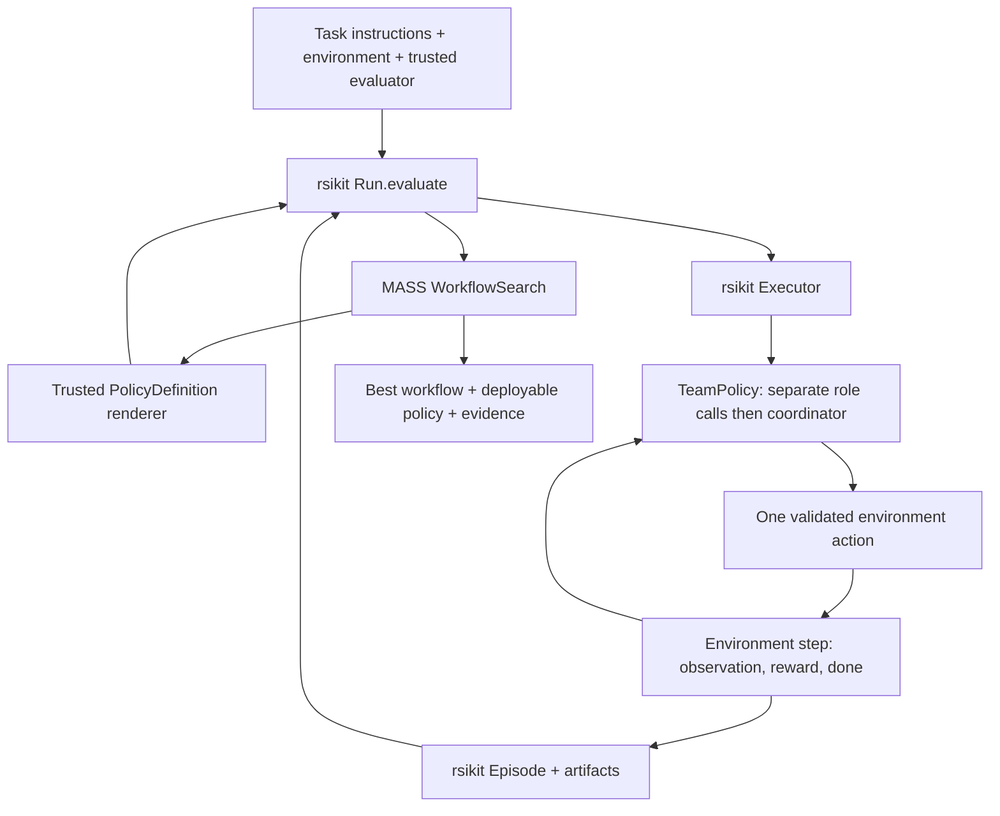

# A general MASS agent on rsikit

Status: implemented with offline verification on 2026-10-10. See [usage and limits](../../agent.md). Live model performance and weight training remain unverified/out of scope.

The user asked for a repository review and an implementation plan for the agent itself, usable on arbitrary tasks, with `~/Developer/AI/rsikit` as its runtime foundation. The user subsequently authorized shared rsikit runtime changes first, then MASS implementation. Algorithm-specific execution/search stays in MASS; general evaluation and evidence contracts live in rsikit.

## Recommendation

Build `mass.agent.TeamPolicy`, an actual interactive, multi-role agent implementing `rsikit.Policy`, and `mass.agent.WorkflowSearch`, a workflow optimizer implementing rsikit's proposal/feedback contract. A task supplies a Gymnasium environment, instructions, and a trusted success/fitness calculation. The agent supplies actions; rsikit executes them and records real feedback. No task numbers, finance/pharmacy/robotics routing, qwen-code installation, or GPU training are required to use this agent.

The first release includes frozen-workflow execution and measured workflow search. It is a MASS-inspired RHI implementation, **not the complete recursive model-training algorithm**. Weight updates remain a separate integration described below. This scope and the sequential team topology are design recommendations, not additional user requirements.

## Repository review

Evidence is from local checkouts, not a verification of the paper or reported benchmark scores:

- MASS: `fb403581bed2c974b3f99e7236224169da643079`.
- rsikit: `d2ed36148f13dfebb8a189fb5d0d82de87c68b9b` (experimental 0.0.1).
- Local Bitcoin-task work, including changes to README files, configs, prompts, and `docs/bitcoin.md`, is outside this design and must be preserved.

| Finding | Source | Consequence |
| --- | --- | --- |
| MASS orchestrates experiments rather than exposing an interactive agent. | `mass/pipeline.py`: `episode`, `search`, `main`; `runtime/run_episode.sh` | Add a separate runtime-facing agent entry point; preserve the existing research stages. |
| Execution currently shells out to qwen-code with host-visible YOLO access. | `runtime/run_episode.sh` | Do not make this launcher the default for arbitrary tasks. Use rsikit's policy/environment boundary. |
| Task selection is numeric and file-based; configuration requires a local endpoint and paper-specific training settings even before running a stage. | `mass/pipeline.py`: `validate`, `query_name`, `main` | The new entry point must dispatch before loading/validating the paper configuration. |
| Workflow parsing requires `queryNN_ourTeam` filenames and prose delimiters. | `harness_improvement/iterate_multi_agent_prompt.py`: `_read_query_template` | Introduce validated workflow data rather than extending the 2,500-line script. |
| Judges select domain lenses by task-number ranges and load fixed task paths. | `mass/judging.py`; `evaluation_claudecodex/pairwise_prompts.py` | Task adapters own fitness and acceptance. Do not carry domain-number inference into the agent. |
| Existing RHI uses a fixed reference and champion arbitration, a documented departure from the paper. | `docs/reproduction.md`; `_derive_champion_baseline` | Make the new numeric selection rule explicit; do not call it a faithful reproduction of Algorithm 1. |
| rsikit already has interactive policies, complete episodes, process workers, source identities, persistence, and optimizer contracts. | `rsikit/policy.py`, `evaluation.py`, `execution/`, `run.py`, `optimization.py` | Reuse these APIs. Do not build another task queue, trajectory format, or evaluation loop. |
| rsikit's `Run.evaluate` accepts source definitions, and identity hashes name plus source. | `rsikit/run.py`; `PolicyDefinition.id` | Render a small trusted `Solution(TeamPolicy)` definition embedding immutable configuration so workflows can be evaluated and saved normally. |
| Failed episodes cannot contribute partial rewards to selection. | `episode_error`, `episode_scores`, `SequentialOptimizer.update` | Preserve that contract; a partially successful panel cannot win. |
| Worker isolation is not a hostile-code sandbox. | `Executor` docstring; rsikit README | Task capabilities and deployment containment remain caller-owned. Never claim workers protect the host. |

Verified baseline: MASS's offline suite ran 12 tests, with 11 passing and the RHI test skipped because core dependencies were unavailable in the selected interpreter. rsikit's optimizer-contract, port-contract, and package-boundary suites passed all 21 tests. No live model calls, GPU jobs, or full rsikit suite were run.

MASS's `NOTICE.md` says its code has no public open-source license. Keeping this implementation in MASS avoids silently copying that code into rsikit's Apache-licensed package; public redistribution of MASS still needs an explicit licensing decision.

## Why this shape

Three approaches were considered:

1. Generalize the qwen-code shell pipeline. This preserves the old experiment most closely, but leaves rsikit peripheral and retains the task-file and workspace assumptions.
2. Build a new general agent framework. This duplicates rsikit's runtime and creates unnecessary lifecycle and storage work.
3. **Implement the agent as an rsikit policy and its workflow search as an rsikit optimizer.** This uses rsikit as the runtime foundation and keeps MASS responsible for its distinctive team/workflow behavior.

## What “arbitrary tasks” means

The agent has no built-in task IDs or domain assumptions. It accepts any task with an explicit observation/action interface, a reset/termination lifecycle, and a trusted evaluator. This includes Gym control tasks, text-answer tasks, and tool/workspace tasks exposed through an environment adapter. It does not imply automatic access to every browser, filesystem, API, or device.

The application supplies a `gymnasium.Env` with:

- `instructions`: nonblank task text describing the observations and valid action representation.
- `observation_space` and `action_space` with working `to_jsonable` / `from_jsonable` methods.
- Standard `reset(seed=...)`, `step(action)`, and `close()` behavior.
- Finite numeric rewards; optional terminal `info['fitness']` overrides total reward for selection. Higher is better. A lower-is-better metric must be negated by the adapter.
- Optional terminal `info['answer']` for a final answer, and rsikit-compatible artifact collection when files are produced.

Environments for workflow search must be resettable and safe to repeat. A real tool task with irreversible effects runs in **solve mode** once; search uses a simulator, dry run, or isolated resettable copy. The optimizer cannot infer that repeating a tool action is safe.

The initial CLI accepts a trusted Python `module:factory` that returns an environment. This is executable application configuration, not model-generated configuration. Ship small offline control and text/tool fixtures to prove that the agent is not tied to one action type. Do not add a universal shell/browser tool package in this release.

## Agent contract

`TeamPolicy` subclasses `rsikit.Policy` and implements `reset`, `act`, `observe`, and `close`. It can be used directly with `rsikit.evaluate`, or through `PolicyDefinition` and `Run.evaluate` for worker execution and persistence.

Workflow data contains an ordered list of one to four roles. Each role has a unique nonblank ID and nonblank instruction. The last role is the coordinator. A single-role workflow is the bare baseline. The default team has proposer, critic, and coordinator roles; callers may supply another validated initial workflow.

For each real environment action:

1. Encode the current observation using the environment space's JSON conversion. Include immutable task instructions, bounded prior real transitions, and the active role's instruction.
2. Invoke each role separately, in order, with the same model configuration and a fresh request context. Later roles receive earlier roles' advice for this decision. This is real multi-role execution, not a single prompt asking one call to impersonate a team.
3. Non-final roles return `{'advice': str}`. The coordinator returns `{'action': JSON value}`. Do not ask for hidden reasoning; record requests, observable advice, actions, usage, and results.
4. Decode the final value with `action_space.from_jsonable([value])[0]` and require `action_space.contains(action)` before returning it. rsikit then applies that one action.
5. `observe` records a public projection of the real transition: space-encoded observation, action and next observation, numeric reward, termination and truncation flags. Never serialize arbitrary `Transition.info` or artifacts into prompts. An adapter may explicitly expose a bounded string under `info['mass_feedback']`; that is the only task-info field allowed in model context. Advisor outputs are not observations or reward evidence. Ended episodes require a reset before another action; a second `act` before feedback for its pending action is an error.

No role receives hidden evaluator data, held-out results, credentials, or the ability to rewrite its budget. Adapters must keep hidden answers out of public observations and `mass_feedback`. Search feedback contains workflow data, scalar selection scores, explicitly public `mass_feedback`, and fixed failure categories only; raw exception strings, arbitrary info, artifacts, and held-out results remain out of prompts. Detailed diagnostics may be retained locally. Roles do not spawn additional roles at runtime. Workflow revisions can change role count and instructions between episodes, within fixed bounds.

Use a small `AgentBackend` with the existing backend choices and JSON/Responses-text helpers, leaving the paper pipeline's synchronous `JsonLLMBackend` unchanged. Construct an AsyncOpenAI client inside policy reset, never serialize a client into workers, and close it before reset/at cleanup. A total asyncio deadline bounds each logical call, including revision calls in the parent. SDK retries and background jobs are disabled; a specific LM Studio JSON-format rejection permits one recorded compatibility retry. Async transport replaces the originally proposed thread wrapper because a cancelled thread can outlive the worker deadline.

Model-response parsing failures must be distinguishable from transport failures. Introduce a `ModelOutputError(RuntimeError)` for the JSON parser's existing output-error paths, without changing what successful callers receive. New runtime code treats that and response-schema/action failures as candidate errors. SDK/connection failures become rsikit `InfrastructureError`; cancellation propagates. A timeout can terminate a worker, but cannot guarantee that a remote server stops billing an already accepted request.

## Configuration and identity

Use strict, extra-forbidden Pydantic models in `mass/agent/schema.py`:

- `Role(id, instruction)` and `Workflow(roles)`.
- `ModelConfig(backend, model, base_url, api_key_env, max_output_tokens=2048, timeout_seconds=60.0)`. API keys are read from the named environment variable inside the worker; never embedded in source or logs. A local unauthenticated vLLM endpoint may use `EMPTY` when explicitly configured for that backend.
- `AgentLimits(max_steps=16, max_model_calls=64, max_context_bytes=32768, episode_timeout=300.0)`.
- `SearchConfig(revisions=3, selection_seeds=(0, 1), heldout_seeds=(100, 101))`.

Require finite positive limits, nonnegative integer seeds excluding booleans, distinct seeds within each panel, and disjoint selection/held-out panels. Zero revisions is allowed. Reject invalid workflow/model/task configuration before creating workers or making calls.

`policy_definition(workflow, model, limits, *, task_fingerprint) -> PolicyDefinition` renders only a trusted class definition with canonical JSON configuration loaded as data. No model-generated Python is inserted into the definition. Include the agent implementation version, task fingerprint, workflow, model configuration, and limits in its source identity. The task fingerprint covers task instructions, environment factory identifier/kwargs, and a caller-supplied `task_version`; bump that version when data or evaluator semantics change.

Keep API secrets out of the fingerprint. Keep a stable policy name; store candidate/attempt numbers in event records so repeated identical workflows produce identical policy IDs. Run directories must not be reused for another task/config/model revision.

## Workflow search

`WorkflowSearch(SequentialOptimizer)` owns the proposal sequence, records, and selected workflow. It yields the rendered `PolicyDefinition`, letting `rsikit.search` and the caller's `Run.evaluate` execute it. `best` is the best accepted policy; `best_workflow` is its workflow.

The sequence is:

1. Evaluate the single-role baseline on all selection seeds.
2. Evaluate the initial team on the same selection seeds, unless identical to the baseline.
3. For each configured revision, ask the same frozen model for a revised workflow using the best available workflow, latest failed/losing attempt, per-seed scores, and bounded diagnostics. Evaluate the proposal on that same panel.
4. Replace the incumbent only on a strictly higher arithmetic mean fitness from a complete, wholly successful panel. Ties retain the incumbent. No baseline victory threshold is required to return the baseline.
5. Evaluate the final retained policy once on held-out seeds. Those results never go back into search or influence selection. If held-out evaluation fails, report the failure without relabeling the candidate as validated.

Malformed workflow proposals consume a revision and are recorded; they do not trigger unlimited repairs. A duplicate policy is recorded as a duplicate and consumes a revision without reevaluating it. All-failed execution ends with `best=None`, clear diagnostics, and a nonzero CLI exit. Infrastructure errors interrupt the run and preserve the incumbent; they are not scored as poor workflows.

For exact requested-seed enforcement, `WorkflowSearch.update` must call `validate_results` against the outstanding ID, require **every panel, including failed panels**, to contain exactly the configured selection seeds, validate fitness, then delegate to the base update. The base class alone permits empty/partial failed panels and infers a successful panel; this design intentionally requires stronger feedback completeness.

The numeric rule differs from MASS's pairwise, fixed-reference/champion protocol. It is appropriate for rsikit's measured task fitness and must be stated in documentation and run metadata. A self-judge may be implemented by a task adapter, but its score is a subjective estimate and not independent validation.

## Bounds, failures, and evidence

- Before each model call, reserve one of the episode's `max_model_calls`; errors count. Before beginning a decision, require enough remaining calls for every role. Never execute a partial team action.
- Cap request context bytes. Preserve task instructions and current observation; remove oldest history first, then oldest diagnostics. If required context or current-step advice still exceeds the cap, reject the decision explicitly rather than truncate JSON or silently lose constraints.
- Candidate evaluations: at most `2 + revisions`; episode budget: at most `(2 + revisions) * len(selection_seeds) + len(heldout_seeds)`. Duplicates reduce this count. Revision generation adds at most `revisions` logical model calls. Record logical calls separately from any transport-level requests.
- The updated `Run.evaluate` accepts `max_steps`, a trusted `feedback` projection, an immutable `evaluation_key`, and `retry_failed=False`. `Episode.stop_reason` distinguishes evaluator step exhaustion from natural completion and task-owned truncation, including on the last allowed step. MASS selects only eligible complete panels; it does not alter factual episodes or generic rsikit scoring. `PolicyBudgetExceeded` marks model-call exhaustion; `Executor(episode_timeout=...)` bounds workers.
- Save workflows, proposal responses, selected IDs, config/source digests, failures, per-seed scores, and held-out results. rsikit owns policy source, actual episodes, and artifacts. Reuse its event sink plus small atomic JSON checkpoints instead of adding a duplicate SQL event table.
- rsikit binds `Policy.context` before reset, carrying a trusted `EvaluationContext` with a durable per-policy/per-seed/per-attempt directory. Workers append and flush events directly there; no global trace-root variable or policy-ID recomputation is needed. Direct policy use may omit tracing. Worker death can leave a started-but-unfinished call; that is retained evidence, not proof of completion or permission to replay.
- There is no automatic restart or replay of actions in v1. Saved episodes are evidence; an interrupted generator is not a resumable search checkpoint. The CLI refuses an existing output directory.

## Integration boundaries

Add `python -m mass agent solve ...` and `python -m mass agent search ...`, dispatching in `mass/__main__.py` before importing the existing pipeline. Existing `plan`, `search`, `collect`, `rank`, `select`, `render`, `train`, `export`, `rollout`, and `report` behavior remains intact.

The new CLI accepts `--task PATH`, `--config PATH`, and `--output PATH`. Task JSON contains `instructions`, `environment` (`module:factory`), `environment_kwargs`, and `task_version`. Agent config contains model, limits, initial workflow, and search settings. `solve` uses the initial workflow and exactly one explicit `--seed` (default 0); it does not run workflow optimization or held-out evaluations. Library consumers can instantiate policies without the CLI.

Use a separate agent dependency file and setup instructions. Install the existing rsikit checkout into a dedicated environment with `python -m pip install -e ~/Developer/AI/rsikit` plus MASS's agent requirements. Do not put an absolute developer path in committed dependency metadata. Record the rsikit revision and runtime version in run metadata. Keep imports lazy so paper-stage commands and core-only tests do not require rsikit.

No rsikit source changes are required initially. In particular, do not alter `Policy`, `Episode`, `Run.evaluate`, `SequentialOptimizer`, or the research-package import rules to accommodate MASS.

## Model training is a later, separate deliverable

Full MASS additionally collects successful team trajectories, ranks within tasks, selects disjoint training/validation data, trains model weights, and repeats workflow search with the new model. This repository already has most of those stages, but its renderer consumes qwen-code request logs. New agent traces are not automatically training-ready.

Before claiming full MASS, add a versioned trace-to-conversation adapter with explicit assistant/tool boundaries, split manifests keyed by task identity, existing assistant-only loss-mask checks, and model-generation provenance. Reuse `mass/ranking.py` and the training pipeline where their contracts fit. Make model-serving/reload and GPU training explicit experiment operations. Acceptance requires an actual completed model-update cycle; mocked training does not establish it. Do not fold this into the inference-agent release or imply that workflow search changes model weights.

## Completion criteria

1. One frozen workflow executes on a discrete-action environment and on a structured tool-action environment without changes to agent code.
2. Every role runs through a separate call; only the coordinator's valid action reaches the environment once.
3. Search promotes a measured improvement, retains a better baseline, and rejects failed panels and invalid workflows.
4. An unseen task name and factory work without adding task IDs or domain-specific branches.
5. A real rsikit worker executes a rendered policy; run storage reloads its episodes and preserves policy identity.
6. Held-out seeds, evaluator-only information, and credentials are excluded from model-visible search feedback.
7. Malformed responses, invalid actions, provider outages, exhaustion, cancellation, and worker timeout leave understandable evidence.
8. Existing MASS offline tests and configuration previews still work without the new runtime installed.

Performance improvement is an empirical question. The initial release is complete when these contracts work, not when a scripted test reports a higher score.

## Design review resolution

A fresh builder review identified scoreable truncation, unfiltered evaluator information, and an unspecified worker trace path. With user authorization these were resolved in rsikit itself through stop reasons, feedback projection, and durable evaluation context, then consumed by MASS. Independent implementation review additionally found silent integer-action coercion inside composite Gym spaces and an unbounded total duration for parent-side revision calls. Regression tests preceded both fixes. Validation is offline; no live-model quality or complete weight-update cycle is claimed.
